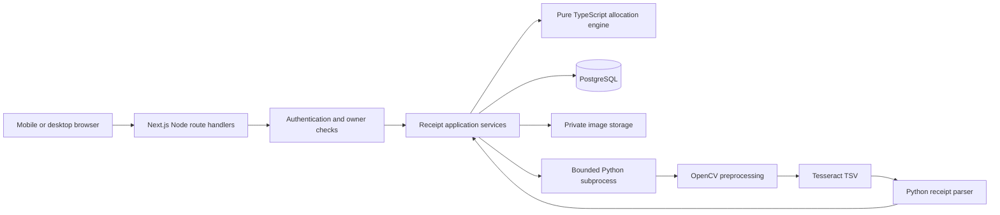

# Architecture specification

Status: approved. ADR-001 and ADR-002 accepted 2026-10-16. Local implementation underway.

## Discovery

On 2026-10-16 the workspace /Users/danik/Desktop/projectforresume was empty, including hidden entries other than . and ... It is not a Git repository. No existing code, dependencies, architecture, reusable components, or ancestor AGENTS.md were found. No functionality needs migration. Node and npm, Python, and psql executables are on PATH; Tesseract and Docker are not. Availability does not establish server connectivity, installed Python libraries, runtime compatibility, or deployment readiness. No dependencies were installed or services provisioned.

## Decisions and alternatives

| Problem | Reasonable alternatives and tradeoffs | Recommendation and reason |
|---|---|---|
| Web/UI/API ownership | Next.js full stack keeps contracts and deployment together; React + Express adds a second application and cross-origin coordination; Python-first Django supplies auth/admin but splits frontend and business language | Next.js App Router with Node route handlers and React/TypeScript. A single web framework fits a small organizer application. No Express layer. |
| Native CV execution | Python subprocess keeps OpenCV ecosystem without HTTP operations; FastAPI worker adds deployment/auth/network/retry overhead; pure Node/browser OCR avoids Python but complicates CV parity and device resource predictability | One bounded Python invocation per processing attempt on the same host. A separate service is justified only by measured concurrency/resource isolation needs or a chosen host's constraints. |
| OCR engine | Tesseract is local and reproducible but receipt layout varies; cloud receipt APIs may improve structure but add per-use cost and third-party data handling; LLM extraction adds nondeterminism and validation burden | OpenCV plus Tesseract CLI with TSV output; conservative parser and human review. Evaluate before expanding scope. |
| Parsing language | Python can reuse OCR tokens directly; TypeScript can share types with UI but requires moving parsing behavior across runtime boundaries | Python owns OCR geometry and receipt parsing; TypeScript owns reviewed receipt validation and money. Runtime-validated JSON is the only cross-language boundary. |
| Persistence | SQLite simplifies installation but differs from desired hosted concurrency model; ORM accelerates modeling but adds tool/schema conventions; PostgreSQL + SQL is explicit and capable | PostgreSQL, node-postgres, parameterized repository functions, numbered SQL migrations with checksums and advisory migration lock. Keep type/runtime mapping centralized. |
| Authentication | Managed auth adds vendor/config surface; custom passwords add substantial security work; maintained OAuth library avoids password handling | Auth.js + Google OAuth, secure server session, stable owner ID mapped to provider identity. Validate supported stable package compatibility in M0; if unavailable, propose an ADR before substituting. |
| Image storage | Public filesystem leaks data; object storage adds service integration; DB binary storage simplifies consistency but inflates backups | Private persistent volume outside public/, opaque keys and authorized streaming. Same-host MVP, with backup and deletion recovery. Abstract a small storage interface for a later object-store move. |
| Processing lifecycle | Synchronous bounded execution is simple but occupies a request; detached background task can disappear on restart; durable queue/worker adds another lifecycle | Bounded request with durable attempt state, single-host one-active-OCR semaphore, busy response, heartbeat/deadline recovery. No detached work or queue initially. |
| Hosting | Container-capable persistent host supports native binaries/volume; ephemeral serverless requires a different storage and native processing design | One Linux container/host behind HTTPS reverse proxy plus PostgreSQL. Local development may use native installs if Docker is unavailable. Do not assume Vercel can run this design unchanged. |
| Tests | Mock-only OCR tests miss quality; live OCR in every test is slow and platform-sensitive | Pure-domain tests plus frozen token parser fixtures, a smaller real OCR corpus run, PostgreSQL integration, and browser workflow tests. |

## Logical flow

Browser preview and server finalization use the same pure money rules; server loads and validates persisted input independently. Python never owns the database or sees OAuth secrets. It receives an internal image path and fixed options, and returns one JSON document. Do not pass user-supplied executable names, arbitrary file paths, remote URLs, or shell commands.

## Proposed repository layout (not created during planning)

- src/app/: pages and /api/v1 route handlers.
- src/components/: review, assignment, and summary UI.
- src/domain/: cents parsing, validation, allocation, finalization rules.
- src/server/: auth, application services, repositories, storage, OCR adapter.
- python/splitcart/: preprocessing, Tesseract adapter, parsing, CLI contract.
- db/migrations/: reviewed ordered SQL migrations.
- tests/{unit,integration,e2e,contracts}/ and python/tests/.
- tests/fixtures/: synthetic/redacted images, token fixtures, and ground truth manifests.
- Dockerfile and compose.yaml: introduced only when their milestone needs them.

## Operation and failure model

A receipt draft exists before upload. Upload is byte-bounded, signature-checked, dimension-checked, decoded in a resource-bounded Python process, then normalized to strip metadata. Preserve the original privately as evidence; display a sanitized derivative. Unique owner/hash constraint detects exact duplicates. Filesystem and DB writes use staging and compensating cleanup; finalization alone is a DB transaction.

Processing records an attempt ID, input receipt version, start/deadline, and state. The web process supervises Python and its Tesseract descendant; kill the entire process group on timeout/disconnect, with escalation after a grace period. A timed-out or restarted attempt becomes failed on the next read/retry/startup sweep. Compare-and-swap protects edits made while OCR ran; OCR never overwrites reviewed data. There is no implied exactly-once external process execution.

Proposed initial guards: 10 MiB upload, 25 megapixels decoded, 500 receipt rows, 50 participants, 100 adjustment rows, 60-second processing deadline, 4 MiB subprocess output, and one active OCR attempt per host. These are configurable limits to test, not measured throughput or latency guarantees. Reverse-proxy timeout must exceed the process deadline and cleanup grace. Revisit with actual corpus and target-host measurements.

## Security and deployment

HTTPS; secure HttpOnly SameSite cookies; CSRF/origin protection for all mutations; runtime schemas; ownership lookup at repository boundary; private/no-store receipt responses; authenticated images; rate and resource limits; secrets only on server; structured metadata-only logs. Authentication-free local development requires an explicit development flag, loopback binding, and a startup refusal in production.

M7 demonstrates a migration on an empty DB, restoration of DB and private volume together, cleanup recovery, and mobile capture on HTTPS. One host is a deliberate scale boundary. Multi-instance operation requires shared storage, distributed capacity control, and durable job coordination documented in a new ADR.

## Verified reference material

Reviewed on 2026-10-16; exact dependency versions will be checked and pinned during M0.

- [Next.js self-hosting](https://nextjs.org/docs/app/guides/self-hosting): Node/container deployment and reverse proxy guidance.
- [Node child_process](https://nodejs.org/api/child_process.html): subprocess arguments, timeouts, output limits; descendant cleanup remains the application's responsibility.
- [Tesseract quality guidance](https://tesseract-ocr.github.io/tessdoc/ImproveQuality.html): skew and preprocessing affect recognition; does not establish SplitCart accuracy.
- [Vercel runtime constraints](https://vercel.com/docs/functions/runtimes): finite function lifecycle; this is not a native-binary/storage compatibility test.
- [PostgreSQL numeric types](https://www.postgresql.org/docs/current/datatype-numeric.html): exact integer/numeric storage options.
- [Auth.js](https://authjs.dev/getting-started): framework/OAuth integration; supported stable version selection remains a milestone prerequisite.
